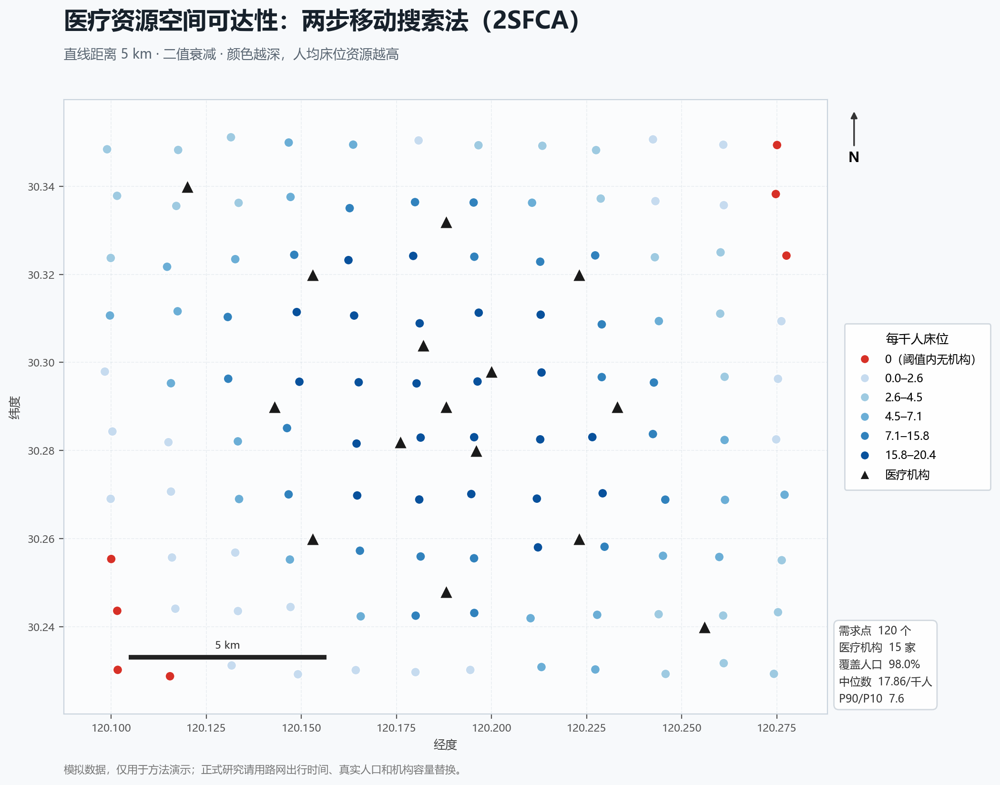
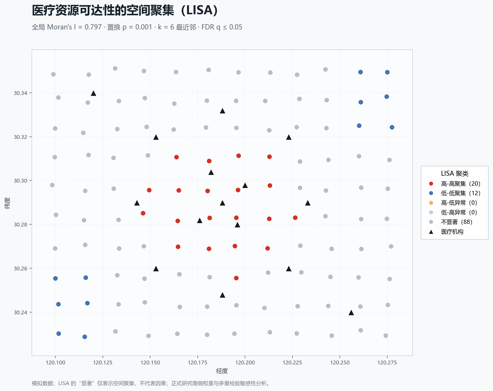
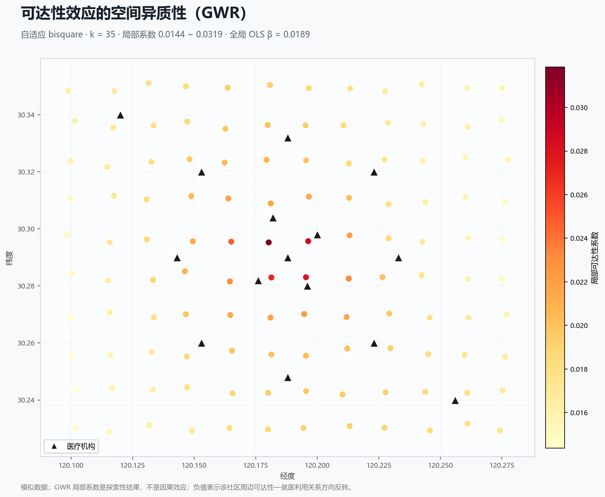
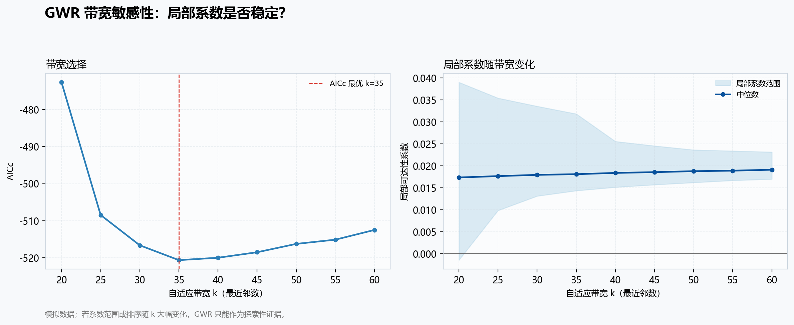

# 医疗资源空间可达性：2SFCA 极简示例

[](https://github.com/barohency-cyber/health-spatial-analysis/actions/workflows/tests.yml)
[](https://barohency-cyber.github.io/health-spatial-analysis/)
[](LICENSE)

面向 **卫生事业管理 / 公共卫生 / 数字治理** 方向的 2SFCA（两步移动搜索法）最小项目：
不用装 ArcGIS，不依赖 GeoPandas，准备好两张 CSV 就能算；算完直接出 CSV、GeoJSON、论文图、可交互网页地图，并能继续做 LISA、SLM/SEM 和 GWR。

> 仓库内全部为**模拟数据**：虚构的“临江市”、120 个社区、15 家医疗机构。
> 机构名、位置、人口、床位均不对应真实地点，可直接公开上传 GitHub。



**在线交互地图：** [barohency-cyber.github.io/health-spatial-analysis](https://barohency-cyber.github.io/health-spatial-analysis/)  
默认使用离线示意底图，不依赖外部瓦片；也可以切换 OpenStreetMap 或影像底图（需联网）。

**现成材料：** [复试讲解卡](docs/复试讲解卡.md) · [论文结果草稿](docs/论文结果草稿.md)

---

## 1. 30 秒跑通

需要 Python 3.10+。核心计算只用标准库，画图需要 matplotlib。

```powershell
python -m pip install -r requirements.txt
python code/two_step_fca.py
```

看到类似输出即成功：

```text
完成：120 个需求点、15 家机构；覆盖人口 98.0%，每千人床位中位数 17.86。
```

不想画图、只要表格：

```powershell
python code/two_step_fca.py --no-map
```

跑单元测试：

```powershell
python -m unittest discover -s tests -v
```

每次 push 后 GitHub Actions 会自动跑单元测试、无图 CLI、LISA、空间回归、GWR、GWR 带宽敏感性和网页地图生成，配置在 [`.github/workflows/tests.yml`](.github/workflows/tests.yml)。

---

## 2. 它算了什么

2SFCA 分两步，核心是同时考虑两件事：

1. **供给端竞争**：一家医院不只服务门口的人，周边居民越多，每个人能分到的床位越少；
2. **需求端多机构叠加**：一个社区可能同时处在几家医院的服务范围内，可达性是这些医院供给能力的总和。

### 第一步：算每家机构的“供需比”

```text
R_j = S_j / Σ(P_i × W_ij)      （只对 d_ij ≤ d0 的需求点求和）
```

- `S_j`：机构 j 的容量，例如床位数、医生数；
- `P_i`：需求点 i 的人口；
- `d_ij`：需求点 i 到机构 j 的距离；
- `d0`：服务阈值，例如 5 km；
- `W_ij`：距离衰减权重。`binary` 表示阈值内权重都为 1；`gaussian` 为截断高斯核。

`R_j` 可以理解为：**这家机构服务范围内，平均每个人能分到多少资源**。

### 第二步：算每个需求点的可达性

```text
A_i = Σ(R_j × W_ij)           （只对 d_ij ≤ d0 的机构求和）
```

`A_i` 的单位是“容量 / 人”。代码乘以 1000，输出 `access_per_1000`，若 `capacity` 用床位数，单位就是**每千人床位**。

> 这不是“居民实际利用了多少医疗资源”，而是“在给定供给、人口和距离阈值下，居民理论上能获得的资源”。论文里要区分 **potential access** 与 **realized utilization**。

经典方法表述见：

- Luo W, Wang F. Measures of spatial accessibility to health care in a GIS environment: synthesis and a case study in the Chicago region. *Environment and Planning B: Planning and Design*, 2003, 30(6): 865–884.

---

## 3. 输入数据格式

只需要两张 CSV，坐标用 **WGS84 经纬度（EPSG:4326）**。

### `data/demand.csv`：需求点（社区 / 街道 / 网格）

| community_id | name | lon | lat | population |
|---|---|---|---|---|
| C001 | 青禾街道01社区 | 120.101701 | 30.230211 | 1280 |
| C002 | 青禾街道02社区 | 120.101575 | 30.243615 | 1110 |

- `community_id`：唯一编号，后面和边界图层连接要用；
- `population`：该需求点的常住人口（或你研究口径下的人口）；
- 一个社区一行，不要重复。

### `data/facilities.csv`：供给点（医院 / 卫生院 / 社区卫生服务中心）

| facility_id | name | lon | lat | capacity |
|---|---|---|---|---|
| F01 | 临江市第一人民医院 | 120.188 | 30.290 | 1500 |
| F06 | 青禾社区卫生服务中心 | 120.143 | 30.290 | 260 |

- `capacity`：机构容量。**整列必须同一单位**，不能一半填床位数、一半填门诊量；
- `capacity` 必须大于 0；没有供给能力的机构请先从供给点表中剔除；
- 如果研究“医疗资源可及性”，常用床位数或执业（助理）医师数；
- 机构可以落在研究区外，但要注意边界效应（见第 7 节）。

### `data/outcomes.csv`：空间回归用的结果变量（可选）

| community_id | outpatient_utilization | elderly_share | income_index |
|---|---|---|---|
| C001 | 0.3760 | 0.1219 | 0.9354 |
| C002 | 0.3758 | 0.1385 | 1.2015 |

- `outpatient_utilization`：两周就诊率（模拟），范围 0–1；
- `elderly_share`：老年人口占比；
- `income_index`：收入指数；
- 这份表只用于 SLM/SEM 演示，运行 `python code/make_outcome_data.py` 会根据可达性结果重新生成。

### 从 QGIS 导出

1. 把需求点/机构点图层的坐标系设为 `EPSG:4326`（WGS 84）；
2. 右键图层 → **导出 → 要素另存为**；
3. 格式选 **CSV**，在“几何”选项中选择 `AS_XY`；
4. 把导出的字段重命名为上表字段名（可在 QGIS 字段计算器里新建 `lon = $x`、`lat = $y`）；
5. 文件编码选 UTF-8（脚本也兼容带 BOM 的 UTF-8）。

如果你只有行政区面图层：

- 用 **矢量 → 几何工具 → 质心** 生成点，再把人口属性带过去；
- 或直接用面图层字段计算器取 `$x`、`$y`；
- 面转点会引入 MAUP 问题，论文里要说明用的是“社区/街道质心”还是“人口加权中心”。

---

## 4. 换成自己的研究

```powershell
python code/two_step_fca.py `
  --demand data/my_demand.csv `
  --facilities data/my_facilities.csv `
  --threshold-km 5 `
  --output-dir output/my_city
```

常用参数：

| 参数 | 说明 |
|---|---|
| `--threshold-km` | 服务阈值，单位 km；示例默认 5 |
| `--decay` | `binary`（阈值内等权）或 `gaussian`（截断高斯） |
| `--output-dir` | 输出目录 |
| `--prefix` | 输出文件前缀，默认 `accessibility` |
| `--no-map` | 只输出表格，不画图 |

做阈值敏感性分析（论文里很加分）：

```powershell
python code/two_step_fca.py --threshold-km 3 --output-dir output/d3
python code/two_step_fca.py --threshold-km 5 --output-dir output/d5
python code/two_step_fca.py --threshold-km 10 --output-dir output/d10
```

然后比较三套结果的排序是否稳定（例如 Spearman 相关系数）。**不要只挑一个看起来最显著的结果写进论文。**

---

## 5. 输出怎么用

| 文件 | 用途 |
|---|---|
| `output/accessibility.csv` | 主结果表；按 `community_id` 连回 QGIS 面图层做分级设色 |
| `output/accessibility.geojson` | 可直接拖进 QGIS / kepler.gl / GitHub 预览 |
| `output/accessibility_summary.json` | 覆盖人口、均值、中位数、P10/P90 等汇总指标 |
| `output/accessibility_map.png` | 快速检查用图；正式论文图建议在 QGIS 里重做 |
| `output/accessibility_map.svg` | 矢量图，可进 Illustrator / Inkscape 调整 |
| `output/lisa.csv` | 每个社区的局部 Moran's I、FDR q 值和 LISA 聚类类型 |
| `output/lisa.geojson` | LISA 结果空间数据，可拖进 QGIS 做聚类图 |
| `output/lisa_summary.json` | 全局 Moran's I、置换检验、各类聚类数量 |
| `output/lisa_map.png` | LISA 高低值聚类图 |
| `output/lisa_map.svg` | LISA 矢量图，便于排版修改 |
| `output/spatial_regression_coefficients.csv` | OLS / SLM / SEM 系数、标准误、直接/间接效应 |
| `output/spatial_regression_fits.csv` | 三个模型的 logL、AIC、BIC、残差 Moran's I |
| `output/spatial_regression_fitted.csv` | 每个社区的实际值、拟合值和残差 |
| `output/spatial_regression_summary.json` | 模型比较、LR 检验和方法说明 |
| `output/gwr_coefficients.csv` | 每个社区的 GWR 局部系数、局部 t 值、局部 R² |
| `output/gwr_summary.json` | 带宽选择、AICc、局部系数范围和共线性诊断 |
| `output/gwr_map.png` | GWR 局部可达性系数地图 |
| `output/gwr_sensitivity.csv` | 不同带宽下的 AICc、局部系数范围和稳定性 |
| `output/gwr_sensitivity.png` | 带宽敏感性双面板图 |

字段解释：

- `access_per_1000`：2SFCA 可达性，数值越高表示人均资源越多；
- `facilities_in_catchment`：阈值内机构数量；为 0 表示“医疗资源空白区”；
- `nearest_facility_km`：最近机构的直线距离，只作辅助，不等于可达性。

### 在 QGIS 里做论文图

1. 把 `accessibility.geojson` 拖进 QGIS；
2. 用 **按字段连接**（Join attributes by field value）把 `access_per_1000` 连到社区/街道面图层，连接字段为 `community_id`；
3. 图层属性 → 符号化 → **分级** → 字段选 `access_per_1000`，分 5 类，选单色系色带；
4. 新建打印布局，加比例尺、指北针、图例、数据来源；
5. 导出 300 dpi PNG 或 PDF。

### 交互地图（GitHub Pages）

在线打开：<https://barohency-cyber.github.io/health-spatial-analysis/>

- 点击圆点查看社区人口、每千人床位、阈值内机构数和最近机构距离；
- 右上角可切换「离线示意底图 / OpenStreetMap / 影像底图」和「5 km 服务范围」；
- 默认离线底图不依赖外部瓦片，网络不好也能正常展示点位和配色。

本地重新生成：

```powershell
python code/make_web_map.py
python -m http.server 8000 -d docs
```

然后打开 <http://localhost:8000/>。网页地图用 Leaflet 直接生成，不需要额外安装 folium。

### 结果解读示例

```text
研究区 120 个社区中，98.0% 的人口在 5 km 直线距离内至少能到达一家医疗机构；
但可达性分布并不均衡：每千人床位中位数为 17.86，P10 仅为 2.65，P90 为 20.18，
P90/P10 约为 7.6。高值区集中在市中心，低值区和 0 值区主要出现在东北、西南边缘，
提示这些区域存在医疗资源覆盖不足的风险。
```

注意：`P90/P10` 在 `P10 = 0` 时没有定义，脚本输出 `null`，不要硬写成无穷大。

### 一个容易被问倒的点

在封闭研究区、且每家机构都至少服务到一个需求点的假设下，**人口加权平均可达性会等于“总容量 ÷ 总人口”**。这是 2SFCA 的守恒性质，不是bug。所以：

- 不要只报“平均每千人床位”；
- 要同时看中位数、P10/P90、覆盖率和空间分布；
- 平均值相同，不代表资源分配公平。

### 空间格局：Moran's I 与 LISA

可达性算完后，下一个问题是：**高值区和低值区是随机散落，还是成片聚集？**

```powershell
python code/spatial_autocorr.py
```

默认参数：`k = 6` 个最近邻、行标准化空间权重、999 次随机置换、FDR 校正 `q ≤ 0.05`。

示例结果：

```text
全局 Moran's I = 0.797，置换 p = 0.001
高-高聚集 20 个，低-低聚集 12 个，高-低/低-高异常 0 个，不显著 88 个
```

怎么读：

- **全局 Moran's I > 0 且 p 很小**：可达性整体呈空间聚集，不是随机分布；
- **高-高（High-High）**：高可达性社区被高可达性邻居包围，示例中集中在市中心；
- **低-低（Low-Low）**：低可达性社区连片，示例中出现在东北、西南边缘；
- **高-低 / 低-高**：局部异常值，表示该社区与邻居“反差大”；
- **不显著**：在控制 FDR 后，没有足够证据认为它属于某种聚集。



实现细节：

- 全局：`I = (n / S0) × ΣΣ w_ij z_i z_j / Σ z_i²`，`z_i` 为可达性对均值的偏离；
- 局部：`I_i = z_i × Σ w_ij z_j / m2`，聚类类型由 `z_i` 和空间滞后 `Σ w_ij z_j` 的符号决定；
- 空间权重用 k 近邻而不是行政邻接，适合社区/网格这类不规则点位；
- 局部显著性用条件置换，最后做 Benjamini-Hochberg FDR，避免“检验 120 次挑显著”；
- `lisa.csv` 里的 `local_i` 是局部 Moran's I，`cluster` 才是最终聚类类型；
- 权重定义、k 值、距离口径都会影响结果，正式论文要做敏感性分析。

局限：LISA 的“显著”只说明空间聚集，不说明因果；k 近邻和直线距离会忽略路网、行政边界和空间异质性。置换次数（99/199/999）和随机种子也会让边缘个案略有变化，论文里应写明参数并做稳健性比较。不要把它写成“高可达性导致某健康结果”。

### 空间回归：OLS / SLM / SEM

如果研究问题是“可达性是否影响就医利用”，可以在 LISA 之后做空间计量：

```powershell
python code/make_outcome_data.py     # 已带 data/outcomes.csv，可跳过
python code/spatial_regression.py
```

演示设定：

- 因变量：`outpatient_utilization`（两周就诊率，模拟）；
- 自变量：`access_per_1000`、`elderly_share`、`income_index`；
- 空间权重：k = 6 最近邻、行标准化；
- 模型：OLS、空间滞后（SLM）、空间误差（SEM）。

示例结果：

| 模型 | 可达性系数 | 空间参数 | 残差 Moran's I | AIC |
|---|---:|---:|---:|---:|
| OLS | 0.0189*** | — | 0.409*** | -497.9 |
| SLM | 0.0130*** | ρ = 0.385*** | 0.282*** | -525.1 |
| SEM | 0.0173*** | λ = 0.805*** | 0.041, p = 0.315 | -549.1 |

怎么读：

- OLS 残差仍有显著空间自相关（Moran's I = 0.409, p < 0.001），普通回归的标准误不可靠；
- SLM 的 ρ = 0.385 显著，说明邻居的就医利用会通过空间滞后影响本社区；可达性的直接效应 0.0130，总效应约 0.0211；
- SEM 的 λ = 0.805 且显著，残差 Moran's I 降到 0.041（p = 0.315），AIC 最低，说明空间依赖很大一部分在误差项；
- SLM 和 SEM 都优于 OLS，SEM 的 AIC 更低；三个模型里可达性系数都为正且显著，但这是模拟数据，不能直接当因果结论。

输出文件：

- `spatial_regression_coefficients.csv`：系数、标准误、p 值、直接/间接/总效应；
- `spatial_regression_fits.csv`：logL、AIC、BIC、残差 Moran's I；
- `spatial_regression_fitted.csv`：每个社区的实际值、三个模型的拟合值和残差；
- `spatial_regression_summary.json`：LR 检验和方法说明。

**方法边界**：这是教学用最大似然实现，标准误由数值 Hessian 近似，ρ/λ 的检验在边界上要谨慎。正式论文建议用 `spreg` 或 GeoDa 复核，并做不同 k、不同权重、不同控制变量的敏感性分析；不要只报一个模型的结果。

### 空间异质性：GWR

SLM/SEM 给出的是“全局平均效应”。如果你怀疑**可达性的作用在不同区域不一样**，可以再跑地理加权回归：

```powershell
python code/gwr.py
```

自适应 bisquare 核 + AICc 选带宽，示例结果：

```text
带宽 k = 35
局部可达性系数 0.0144 ~ 0.0319，中位数 0.0181
局部 R² 中位数 0.941
```

解读：

- 市中心局部系数更高（约 0.03），边缘更低（约 0.015），说明可达性对就医利用的关联在中心城区更强；
- 全局 OLS 系数 0.0189 只是一个平均值，会掩盖这种空间差异；
- GWR 的局部系数不是因果效应，也不能直接拿来做政策排序。



输出：

- `gwr_coefficients.csv`：每个社区的局部截距、局部可达性/老年/收入系数、局部 t 值、局部 R²、条件数；
- `gwr_summary.json`：带宽选择、AICc、有效参数、局部系数范围、局部共线性诊断；
- `gwr_map.png/svg`：局部可达性系数地图。

带宽敏感性分析：

```powershell
python code/gwr_sensitivity.py --min-k 20 --max-k 60 --step 5
```

示例结果：k = 20 时局部系数出现小幅负值（最小 -0.0014），k ≥ 25 后全部为正；k = 25–45 与最优 k = 35 的局部系数相关系数均高于 0.97。说明“市中心强、边缘弱”的模式在合理带宽内稳定，但过小带宽会不稳定。



**方法边界**：GWR 对带宽、局部共线性和异常值很敏感。示例中最大条件数超过 60 万，说明部分局部设计矩阵接近共线，局部系数要谨慎解读；正式论文应报告带宽敏感性、局部共线性，并考虑多重比较问题。

---

## 6. 论文与复试表述模板

### 方法段

```text
采用两步移动搜索法（2SFCA）测度医疗资源空间可达性。以社区为需求单元，
以各级医疗机构为供给点，以机构床位数衡量供给容量，以社区常住人口衡量需求规模。
参考已有研究将服务阈值设为 5 km，采用二值距离衰减函数，分别计算每家机构的
供需比 R_j 和每个社区的可达性指数 A_i；A_i 越高，表示该社区在竞争后可获得的
人均医疗资源越多。进一步以人口加权分位数和 P90/P10 描述可达性不平等程度。
```

### 图注

```text
图 X 研究区医疗资源空间可达性分布（2SFCA，服务阈值 5 km）
注：颜色越深表示每千人床位资源越高；红色表示 5 km 内无医疗机构。
基于模拟数据绘制，仅用于方法示例。
```

### 复试 30 秒口述

```text
我用 2SFCA 做医疗资源可达性。第一步，以每家医院为中心，把 5 公里内的社区人口
加总，得到这家医院的供需比；第二步，对每个社区，把它能覆盖到的所有医院的供需比
加起来，就是该社区的人均资源可得性。这样既考虑了居民之间的竞争，也考虑了
跨社区就医。结果用覆盖人口、P10/P90 和空间分布来解读，而不是只看平均值。
这个方法可以用 QGIS 出图，也可以用 Python 复现。
```

---

## 7. 常见坑（医管学生高频踩雷）

1. **把直线距离说成路网可达性。**  
   本代码是 haversine 直线距离。论文若写“路网可达性”，必须换成路网出行时间/距离，否则方法表述不成立。

2. **阈值拍脑袋。**  
   5 km 只是示例。应按研究问题、城市尺度、居民就医行为或文献设定，并做 3/5/10 km 敏感性分析。

3. **边界效应。**  
   研究区外的医院没纳入，边缘社区会被低估；研究区外的居民没纳入，边缘医院会被高估。解决：研究区外扩缓冲带、纳入周边机构，或明确说明假设。

4. **容量单位混用。**  
   床位数、医师数、门诊量不能混在一列。`capacity` 整列必须同单位；换成医师数后，结论要相应改写。

5. **人口口径不一致。**  
   常住人口、户籍人口、老年人口不要混用；需求点人口要与研究问题匹配，并注明来源和年份。

6. **坐标系搞错。**  
   脚本要的是经纬度（WGS84）。把投影坐标（米）当经纬度传进去，距离会完全错误。QGIS 导出前先确认 CRS。

7. **零值不等于“没有需求”。**  
   `facilities_in_catchment = 0` 是“阈值内没有机构”，不是“没有人”。两者要分开解释。

8. **把可达性当成利用率。**  
   可达性高不代表居民真的去看病；就医行为还受医保、价格、信任、交通、服务质量影响。

9. **MAUP 与生态谬误。**  
   社区/街道是人为划分的，换一种划分方式结果可能变化；群体层面的关系不能直接推到个人。

10. **数据合规。**  
    真实边界 shp、地址、问卷个体数据不要随便传公开仓库；公开仓库只放模拟数据、聚合结果或脱敏数据。敏感数据放本地私有仓库，并在 `.gitignore` 中排除。

11. **公式混用。**  
    2SFCA、E2SFCA、3SFCA、Huff 模型的公式不同，不要把一种方法的权重套到另一种方法上还沿用原名。

---

## 8. 仓库结构

```text
.
├── .github/
│   └── workflows/tests.yml   # push 自动跑测试和网页生成
├── code/
│   ├── two_step_fca.py       # 2SFCA 核心 + CSV/GeoJSON/地图输出
│   ├── spatial_autocorr.py   # 全局 Moran's I + 局部 LISA
│   ├── spatial_regression.py # OLS / SLM / SEM
│   ├── gwr.py                # 地理加权回归
│   ├── gwr_sensitivity.py    # GWR 带宽敏感性
│   ├── make_outcome_data.py  # 生成模拟就医利用结果
│   ├── make_web_map.py       # 生成 docs/index.html 交互地图
│   └── make_demo_data.py     # 重新生成模拟数据
├── data/
│   ├── demand.csv            # 需求点（模拟）
│   ├── facilities.csv        # 医疗机构（模拟）
│   └── outcomes.csv          # 就医利用与协变量（模拟）
├── docs/
│   ├── .nojekyll
│   ├── index.html            # GitHub Pages 入口
│   ├── 复试讲解卡.md
│   └── 论文结果草稿.md
├── output/
│   ├── accessibility.csv
│   ├── accessibility.geojson
│   ├── accessibility_summary.json
│   ├── accessibility_map.png
│   ├── accessibility_map.svg
│   ├── lisa.csv
│   ├── lisa.geojson
│   ├── lisa_summary.json
│   ├── lisa_map.png
│   ├── lisa_map.svg
│   ├── spatial_regression_coefficients.csv
│   ├── spatial_regression_fits.csv
│   ├── spatial_regression_fitted.csv
│   ├── spatial_regression_summary.json
│   ├── gwr_coefficients.csv
│   ├── gwr_summary.json
│   ├── gwr_map.png
│   ├── gwr_map.svg
│   ├── gwr_sensitivity.csv
│   ├── gwr_sensitivity_summary.json
│   ├── gwr_sensitivity.png
│   └── gwr_sensitivity.svg
├── tests/
│   ├── test_two_step_fca.py  # 手算例子校验公式
│   ├── test_spatial_autocorr.py
│   ├── test_spatial_regression.py
│   ├── test_gwr.py
│   ├── test_gwr_sensitivity.py
│   └── test_web_map.py       # 校验网页地图生成
├── CITATION.cff
├── LICENSE
├── README.md
└── requirements.txt
```

重新生成模拟数据（会覆盖 `data/` 下的 CSV）：

```powershell
python code/make_demo_data.py
python code/two_step_fca.py
python code/make_outcome_data.py
```

---

## 9. 下一步可以怎么升级

- **换路网**：用 QGIS 的 ORS Tools、OSRM，或高德/百度路径规划 API 生成 OD 时间矩阵，把 `haversine_km` 换成出行时间；
- **换面数据**：用 GeoPandas 把社区面质心化，或直接做面到面 OD；
- **空间自相关**：已内置 `spatial_autocorr.py`，可继续扩展不同 k、距离阈值、Queen 邻接权重，比较结果稳健性；
- **空间回归**：已内置 `spatial_regression.py`（OLS/SLM/SEM）和 `gwr.py`（GWR）；下一步可做因果识别、政策冲击的准实验设计，或空间中介分析；
- **方法扩展**：E2SFCA、3SFCA、Huff 模型；但先把手里的 2SFCA 假设、阈值和边界效应讲清楚，比堆模型更加分。

当前仓库已经设置的描述和 topics：

```text
description: 2SFCA-based spatial accessibility analysis for healthcare resources
topics: health-gis, 2sfca, healthcare-accessibility, public-health, qgis, spatial-analysis,
        leaflet, github-pages, lisa, morans-i, spatial-autocorrelation,
        spatial-econometrics, slm, sem, gwr, geographically-weighted-regression
```

---

## 10. 数据、许可与引用

- 仓库内数据为程序生成的模拟数据，不涉及真实人口、机构或边界；
- 代码以 [MIT License](LICENSE) 开源，可自由修改用于课程作业、论文复现和复试展示；
- 如果这个项目对你的研究有帮助，引用信息见 [CITATION.cff](CITATION.cff)；
- 正式研究请替换为合规数据，并在论文中写明数据来源、年份、口径和伦理审批（如适用）。
